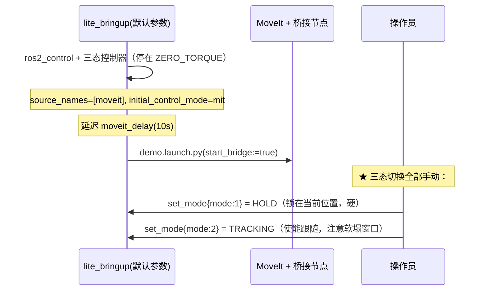

# lite_moveit

Lite 双臂机械臂的 **MoveIt 2 运动规划配置包**：提供运动学求解、轨迹规划、RViz 可视化，
以及把 MoveIt 轨迹桥接到本项目 `lite_bridge` 决策层的节点。

> ⚠️ 本包**改造自参考工程 `lite_ros2`**（原为 BAR Lite + `bar_msgs` + `remote_policy_controller`）。
> 改造点是"把出口接到本项目的 `lite_bridge`"，见下方
> [与 lite_bridge 的接口契约](#与-lite_bridge-的接口契约)。
> 本工程**没有** `bar_msgs` / `remote_policy_controller` / `bar_bringup_lite`。

---

## 目录结构

```
lite_moveit/
├── CMakeLists.txt                        # 构建配置
├── package.xml                           # 包元信息（含依赖订正说明）
├── config/                               # MoveIt 配置文件
│   ├── lite_000_asm.srdf                 # 语义描述（规划组、碰撞矩阵、位姿）
│   ├── lite_000_asm.urdf.xacro           # URDF 模型（xacro 宏）
│   ├── lite_000_asm_resolved.urdf        # 解析后的 URDF
│   ├── lite_000_asm.ros2_control.xacro   # ros2_control 接口
│   ├── kinematics.yaml                   # 运动学求解器配置（KDL）
│   ├── joint_limits.yaml                 # 关节限位与速度/加速度缩放
│   ├── moveit_controllers.yaml           # MoveIt 控制器映射
│   ├── moveit.rviz                       # RViz 可视化配置
│   ├── pilz_cartesian_limits.yaml        # Pilz 笛卡尔规划器限位
│   ├── initial_positions.yaml            # 初始关节位置
│   └── identified_params.json            # 关节摩擦/动力学辨识参数
├── launch/
│   ├── demo.launch.py                    # 核心启动：move_group + RViz + 可选桥接节点
│   ├── one_click.launch.py               # 一键：lite_bringup(默认参数) + MoveIt（模式手动）
│   ├── move_group.launch.py              # 独立 move_group 节点
│   ├── moveit_rviz.launch.py             # 独立 MoveIt RViz
│   ├── rsp.launch.py                     # Robot State Publisher
│   ├── static_virtual_joint_tfs.launch.py# 静态虚拟关节 TF
│   ├── warehouse_db.launch.py            # Warehouse 数据库
│   └── setup_assistant.launch.py         # MoveIt Setup Assistant
└── scripts/
    ├── moveit_remote_policy_bridge.py    # MoveIt → lite_bridge 桥接节点 ★
    ├── torque_compensation.py            # 力矩前馈补偿模块
    └── motor_monitor.py                  # 电机状态监控仪表盘
```

---

## 规划组

| 规划组                | 关节数 | 说明                    |
| --------------------- | ------ | ----------------------- |
| `left_arm_group`      | 7      | 左臂（不含手爪）        |
| `right_arm_group`     | 7      | 右臂（不含手爪）        |
| `arms_group`          | 14     | 双臂（不含手爪）        |
| `left_gripper_group`  | 1      | 左手爪                  |
| `right_gripper_group` | 1      | 右手爪                  |
| `arms_grippers_group` | 16     | 双臂 + 双手爪（全关节） |

---

## 运动学求解

各规划组使用 **KDL Kinematics Plugin**（`kdl_kinematics_plugin/KDLKinematicsPlugin`）：
搜索分辨率 `0.005`，求解超时 `0.005 s`。配置位于 `config/kinematics.yaml`。

---

## 数据流（本工程的实际通路）

```
MoveIt move_group
      │  FollowJointTrajectory action
      │  （action 名：/remote_policy_controller/follow_joint_trajectory，
      │    见 config/moveit_controllers.yaml）
      ▼
moveit_remote_policy_bridge            ◄── torque_compensation（前馈力矩）
      │  robstride_msgs/MotionCommand
      │  topic: /lite_bridge/motion_command
      │  字段: source / mode / joint_names / position / velocity / effort / kp / kd
      ▼
lite_bridge（决策层：多源仲裁 + 协议选择 + 安全降级）
      │  robstride_msgs/JointCommand（全量关节，5 个数组全填）
      │  topic: /tracking_controller/command
      ▼
tracking_controller（三态控制器中唯一读命令的那个）
      │  写 ros2_control 的 5 个 MIT 命令接口
      ▼
lite_driver  ──encode_mit（类型 1 运控帧）──►  CAN (can0 / can1) ──►  电机

`/joint_states`        ◄── lite_bringup 的 joint_state_broadcaster（**只有实机电机关节**）
`/lite_js/joint_states` ◄── joint_state_publisher 补全夹爪等无电机关节后的**整机**话题
```

> ⚠️ **MoveIt 必须订阅补全后的 `/lite_js/joint_states`**（本包默认已如此）：
> `move_group` 的 `PlanningSceneMonitor` 把话题名硬编码成 `joint_states`
> （`moveit_cpp.hpp` 里 `joint_state_topic` 是 `const`，参数改不了），
> 只能用 remap 切到补全话题；否则 `mode:=arms` 下它会一直刷
> `The complete state of the robot is not yet known. Missing left_gripper, right_gripper`。
> 桥接节点与 `move_group` 共用 `one_click`/`demo` 的 `joint_states_topic` 参数
> （默认 `/lite_js/joint_states`）。

⚠️ 与旧文档的差别（都是实测确认过的）：

| 旧描述                                   | 实际                                   |
| ---------------------------------------- | -------------------------------------- |
| 发给 `MITCommand`                        | `robstride_msgs/MotionCommand`         |
| 话题 `/lite/mit_command`                 | `/lite_bridge/motion_command`          |
| 状态反馈 `/lite/joint_states`            | `/joint_states`（驱动）+ `/lite_js/joint_states`（补全后，MoveIt 用这个） |
| 字段 `stiffness` / `damping`             | `kp` / `kd`                            |
| 硬件是 `bar_bringup_lite` + FSM 服务     | `lite_bringup` + `mode_manager` 三态   |
| 需要 `bar_msgs`                          | 需要 `robstride_msgs`                  |

---

## 与 lite_bridge 的接口契约

### 字段映射

| `bar_msgs/MITCommand`（旧） | `robstride_msgs/MotionCommand`（现） | 说明                                   |
| --------------------------- | ------------------------------------ | -------------------------------------- |
| `joint_names`               | `joint_names`                        | 关节名，顺序即数组排布顺序             |
| `position`                  | `position`                           | 期望位置（MIT 的 `p_des`）             |
| `velocity`                  | `velocity`                           | 期望速度（`v_des`）                    |
| `effort`                    | `effort`                             | 前馈力矩（`tau_ff`）                   |
| `stiffness`                 | **`kp`**                             | 位置环刚度                             |
| `damping`                   | **`kd`**                             | 速度环阻尼                             |
| （无）                      | **`source`**                         | ★ 仲裁必需，桥据此认源                 |
| （无）                      | **`mode`**                           | ★ 必须与桥的协议模式一致               |
| （无）                      | `timeout_ms`                         | ⚠️ 桥**当前不读**该字段（填了只为语义完整） |

### 数据要真正到达电机，三个前提缺一不可

1. **桥的 `source_names` 必须含本节点的 `source_name`**（默认 `moveit`）。
   桥默认 `source_names` 是**空列表** —— 空列表下**每条**命令都被丢弃并打
   `丢弃未知数据源 'moveit' 的命令`（而且节点不会崩，很容易误判成"链路没问题"）。
2. **桥的协议模式必须是 MIT**，且与本节点 `control_mode` 参数一致。
   桥默认 `initial_control_mode` 是 `csp`，而本工程的 CSP 是**空壳**：
   命令会被发到 `/csp_controller/command`，那里在三态模式下**无人订阅**。
3. **三态模式必须处于 `TRACKING`**。三个控制器里只有
   `tracking_controller` 读上层命令；`zero_torque` 忽略命令（松劲），
   `hold` 忽略命令（锁在激活时位置）。

`one_click.launch.py` 把 1 和 2 用**同一个 launch 参数**驱动（`source_name` /
`control_mode` 同时传给桥和本节点），所以不可能配岔；3 由它显式调
`mode_manager/set_mode` 完成。手工起的时候要自己保证 —— 见下方"手动起桥"。

### 关于 `mode`（关节集合）

`mode` 决定本节点发多少个关节（`arms` = 14 / `arms_grippers` = 16），
必须与 `lite_bringup` 的 `mode` 对齐。原因：

- **多发**（本节点 16、桥 14）：桥把多出来的关节算作"未知关节"，只打警告，安全。
- **少发**（本节点 14、桥 16）：桥**整帧拒绝**并列出缺哪些关节 ——
  `lite_bridge` 的 `CommandNormalizer` 强制命令必须覆盖全部
  `canonical_joints`（安全不变量 I5），覆盖不全的帧根本进不到驱动。
  这是后来加固的：更早的版本是**静默**给没被本命令触及的关节填
  `position = 0` + 兜底 `Kp = 20` → `τ = 20·(0 − p)` → **那个关节被驱动到零位**。

所以本节点的手工默认值是超集 `arms_grippers`（宁可多发不可少发），
而 launch 会显式传对齐后的值。

---

## 启动方式

### 方式一：仅 MoveIt（仿真 / 离线调试）

不需要硬件，只启动 move_group + RViz：

```bash
ros2 launch lite_moveit demo.launch.py
```

### 方式二：MoveIt + 桥接节点（硬件由别处拉起）

适用于已经用 `lite_bringup` 起好硬件、桥、三态控制器的场景：

```bash
# 1) 起硬件 + 桥，并授权 moveit 数据源（★ 不加 source_names 命令会被丢弃）
ros2 launch lite_bringup lite_bringup.launch.py \
    mode:=arms source_names:=moveit initial_control_mode:=mit

# 2) 切到 HOLD 确认姿态，再切 TRACKING
ros2 service call /mode_manager/set_mode robstride_msgs/srv/SetRunMode "{mode: 1}"
ros2 service call /mode_manager/set_mode robstride_msgs/srv/SetRunMode "{mode: 2}"

# 3) 起 MoveIt + 桥接节点
ros2 launch lite_moveit demo.launch.py start_bridge:=true mode:=arms
```

### 方式三：一键启动（推荐）

```bash
# 默认（arms，14 关节）：
#   起 lite_bringup（source_names:=moveit + initial_control_mode:=mit + mode:=arms）
#   → 停 ZERO_TORQUE；延迟 moveit_delay 后拉起 MoveIt + 桥接节点。
#   三态切换（HOLD / TRACKING）**手动**进行。
ros2 launch lite_moveit one_click.launch.py

# 装夹爪的机型（16 关节；**必须实机真的装了夹爪**）
ros2 launch lite_moveit one_click.launch.py mode:=arms_grippers

# 实机没装夹爪、只空跑验证 arms_grippers 链路
ros2 launch lite_moveit one_click.launch.py use_fake_hardware:=true mode:=arms_grippers

# 硬件已由别处拉起（要用 calibration_file / can_interface_* / controller 等参数），
# 只补 MoveIt 侧。⚠️ 此时 source_names / initial_control_mode / mode 要自己保证。
ros2 launch lite_bringup lite_bringup.launch.py use_fake_hardware:=true
ros2 launch lite_moveit one_click.launch.py skip_bringup:=true
```

执行流程（模式切换手动）：



手动切模式：

```bash
ros2 service call /mode_manager/set_mode robstride_msgs/srv/SetRunMode "{mode: 1}"  # HOLD
ros2 service call /mode_manager/set_mode robstride_msgs/srv/SetRunMode "{mode: 2}"  # TRACKING
ros2 service call /mode_manager/set_mode robstride_msgs/srv/SetRunMode "{mode: 0}"  # ZERO_TORQUE（软）
ros2 service call /mode_manager/get_mode std_srvs/srv/Trigger "{}"                  # 核对
```

---

## 启动参数参考

### `demo.launch.py`

| 参数                         | 类型   | 默认值                        | 说明                                     |
| ---------------------------- | ------ | ----------------------------- | ---------------------------------------- |
| `start_bridge`               | bool   | `false`                       | 是否启动桥接节点                         |
| `mode`                       | string | `arms`                        | 关节集合（`arms` / `arms_grippers`）⚠️ 须与 `lite_bringup` 一致 |
| `source_name`                | string | `moveit`                      | 发给桥的源名 ⚠️ 须在桥的 `source_names` 里 |
| `control_mode`               | string | `mit`                         | 命令的协议字段 ⚠️ 须与桥一致；本工程只有 MIT 通 |
| `command_topic`              | string | `/lite_bridge/motion_command` | `MotionCommand` 下发话题                 |
| `joint_states_topic`         | string | `/lite_js/joint_states`       | `move_group` / 桥接节点订阅的关节状态。⚠️ 必须用补全后的话题，否则 `move_group` 报 `Missing left_gripper, right_gripper`；若关了 `complete_joint_states` 就设 `/joint_states` |
| `stiffness`                  | float  | `20.0`                        | MIT 刚度 Kp                              |
| `damping`                    | float  | `2.0`                         | MIT 阻尼 Kd                              |
| `enable_torque_compensation` | bool   | `false`                       | 力矩前馈补偿（需 `identified_params.json`） |
| `torque_compensation_scale`  | float  | `1.0`                         | 补偿缩放因子                             |
| `integral_gain`              | float  | `0.0`                         | hold 阶段积分增益（0 = 关）              |
| `torque_params_path`         | string | `''`                          | `identified_params.json` 路径（留空自动查找） |

### `one_click.launch.py`

它向 `lite_bringup` 传 4 个参数（`source_names` / `initial_control_mode` /
`mode` / `use_fake_hardware`，默认值都等于 `lite_bringup` 自己的默认值），
其余全部走 `lite_bringup` 默认；**不再自动切任何模式**。
`demo.launch.py` 的桥接相关参数（`stiffness` / `damping` / `command_topic` 等）它都透传。
本文件自己的参数：

| 参数                  | 类型   | 默认值  | 说明                                                     |
| --------------------- | ------ | ------- | -------------------------------------------------------- |
| `skip_bringup`        | bool   | `false` | 不启动 `lite_bringup`（硬件已由别处拉起），只起 MoveIt 侧。⚠️ 此时桥的 `source_names` / `initial_control_mode` / `mode` 要自己保证 |
| `source_name`         | string | `moveit`| ★ 同时用作桥的 `source_names` 与本节点 `source` 字段      |
| `control_mode`        | string | `mit`   | 同时用作桥的 `initial_control_mode` 与本节点 `control_mode` |
| `mode`                | string | `arms`  | ★ 关节集合（`arms`=14 / `arms_grippers`=16）。**同一个值同时下发 `lite_bringup` 与 MoveIt 桥接节点**，两边必然一致。⚠️ 实机没装夹爪时必须 `arms`，否则驱动会去使能不存在的 id 18/28 |
| `use_fake_hardware`   | bool   | `false` | mock 硬件空跑（不碰 CAN）。默认 `false` = `lite_bringup` 默认。想空跑试 `arms_grippers` 就用它 |
| `command_topic`       | string | `/lite_bridge/motion_command` | 下发话题                     |
| `joint_states_topic`  | string | `/lite_js/joint_states` | 与 `move_group` 共用同一关节状态话题（透传给 `demo.launch.py`） |
| `stiffness`           | float  | `20.0`  | MIT 刚度 Kp                                              |
| `damping`             | float  | `2.0`   | MIT 阻尼 Kd                                              |
| `moveit_delay`        | float  | `10.0`  | 起 bringup 后等多少秒拉起 MoveIt + 桥接节点              |

机型切换示例：

```bash
# 双臂（无夹爪，默认）
ros2 launch lite_moveit one_click.launch.py

# 双臂 + 夹爪
ros2 launch lite_moveit one_click.launch.py mode:=arms_grippers

# 实机没装夹爪、只想空跑验证 arms_grippers 链路
ros2 launch lite_moveit one_click.launch.py use_fake_hardware:=true mode:=arms_grippers
```

> 想用其它 bringup 参数（`calibration_file` / `can_interface_*` / `controller` …）：
> 先自己起 `lite_bringup`，再用 `one_click.launch.py skip_bringup:=true` 只补 MoveIt 侧。

---

## MIT 刚度/阻尼（Kp / Kd）怎么调

MIT 控制律（`lite_driver` 下发、电机执行）：

```
τ = Kp·(p_des − p) + Kd·(v_des − v) + τ_ff
```

Kp/Kd 不是全局一个值 —— 按**哪条通路在写命令**分四处，改哪个取决于你要调什么：

| 想调的场景 | 参数 | 位置 | 生效方式 |
| :--- | :--- | :--- | :--- |
| **MoveIt 轨迹**（TRACKING 下执行轨迹时） | `stiffness`(Kp) / `damping`(Kd) | launch 参数：`one_click.launch.py stiffness:=8.0 damping:=2.0` | **重启 launch**（节点启动时只读一次） |
| **HOLD 锁位** | `stiffness_scalar` / `damping_scalar`（或逐关节 `stiffness` / `damping` 数组）+ `ramp_duration` | `/data/lite_motor_ws/src/lite_bringup/config/controllers_mit.yaml` | `colcon build`（lite_motor_ws）+ 重启 bringup |
| **TRACKING 下命令未触及的关节**（兜底） | `default_stiffness` / `default_damping`（当前写死 `20.0` / `1.0`） | `/data/lite_motor_ws/src/lite_bringup/launch/lite_bringup.launch.py`（约 L709） | 重建 bringup（未暴露成 launch 参数） |
| **硬天花板**（超过被驱动静默钳位） | `kp_max` / `kd_max` | `/data/lite_motor_ws/src/lite_driver/include/lite_driver/protocol.hpp` | 重建 lite_driver（一般不用动） |

### 天花板（按电机型号）

本机 16 个关节全是 **rs-00 / rs-02 / rs-05**：

| 型号 | `kp_max` | `kd_max` |
| :--- | ---: | ---: |
| rs-00 / rs-01 / rs-02 / rs-05 | **500** | **5.0** |
| rs-03 / rs-04 / rs-06 | 5000 | 100 |

`scale_unsigned_u16()` 会**静默钳位**，所以 `stiffness:=1000` 实际等于 500，没有意义。

### 常用调法

```bash
# 运动太猛 / 冲击大：降 Kp、适当升 Kd
ros2 launch lite_moveit one_click.launch.py stiffness:=8.0 damping:=2.0

# 跟踪无力 / 跟不上：升 Kp（别超过 500）
ros2 launch lite_moveit one_click.launch.py stiffness:=40.0 damping:=4.0
```

HOLD 逐关节配（例：`arms` 14 关节，大关节 30、腕部 10）：

```yaml
hold_controller:
  ros__parameters:
    stiffness: [30, 30, 30, 30, 10, 10, 10, 30, 30, 30, 30, 10, 10, 10]
    damping:   [ 1,  1,  1,  1,  1,  1,  1,  1,  1,  1,  1,  1,  1,  1]
```

⚠️ 三个坑：

1. 数组长度必须 **== joints**（`arms`=14 / `arms_grippers`=16），否则控制器 `on_configure` 直接报错。
2. **不要写空数组 `[]`**（ROS 2 参数系统不接受空序列）；想用标量就**整个数组键都别写**。
3. `ramp_duration`（HOLD 激活斜坡，默认 0.5 s）是安全网，**别关**：它保证第一拍 τ 恒为 0，否则上一个控制器留下的 `p_des=0` 会让电机在 1 rad 偏差下瞬间输出远超额定的力矩。

### 两个必须知道的语义

- **`Kp=0` 且 `Kd=0` = τ=0 = 松劲**。看起来就像"命令没生效"。桥的 `default_stiffness`
  兜底值因此**必须 > 0**。
- 这两个增益都是**启动时读一次**：MoveIt 桥接节点在 `__init__` 里存成 `self.K/self.D`；
  HOLD 控制器在 `on_configure` 里读。所以 `ros2 param set` 运行期改**不生效**，要按上表重启对应节点。

> 想让机器人"更省力"而不是一味加大 Kp，可以开前馈：`enable_torque_compensation:=true`
> （摩擦 + Pinocchio 重力补偿写进 `τ_ff`），这样同样的刚度下跟踪误差更小、发热更低。

---

## 带夹爪（`mode:=arms_grippers`）怎么发控制

### 前提（缺一不可）

1. **实机真的装了夹爪** → 必须 `mode:=arms_grippers`（驱动才会去使能 id 18/28）。
   没装夹爪却用这个模式，硬件 `activate` 会失败，**两条臂一起起不来**。
   只想验证链路就用 `use_fake_hardware:=true mode:=arms_grippers` 空跑。
2. **夹爪标定端点**在 `lite_calibration/config/calibration.yaml`（**本机已有**）：
   ```yaml
   left_gripper:  {id: 18, direction: -1, interface_type: gripper_opening,
                   closed_position: -0.3244, open_position: 5.7679}
   right_gripper: {id: 28, direction: -1, interface_type: gripper_opening,
                   closed_position: -0.2339, open_position: 5.8830}
   ```
   缺了会退化成"把弧度当米"的恒等映射，开度约 1 rad 后就饱和（驱动会打 WARN）。
3. **桥的 `canonical_joints` 含夹爪** —— 由 `mode:=arms_grippers` 自动带上
   （`lite_bringup` → `use_grippers:=true`）。
4. **`config/moveit_controllers.yaml` 的 `remote_policy_controller.joints` 要列出夹爪。**
   少了 `left_gripper` / `right_gripper` 时，规划 `left_grip_group` /
   `right_grip_group` / `arms_grippers_group` 会在**执行**阶段失败：

   ```
   [ERROR] trajectory_execution_manager: Unable to identify any set of controllers
           that can actuate the specified joints: [ left_gripper ]
   [ERROR] plan_execution: Apparently trajectory initialization failed
   [INFO]  move_action: CONTROL_FAILED
   [ERROR] rviz: MoveGroupInterface::move() failed or timeout reached
   ```

   （本文件已包含这两个关节；多写是安全的 —— 轨迹关节是列表子集即被接受。）
5. **桥接节点的 `mode` 必须与 bringup 一致。** 两边不一致时（典型：bringup 是
   `arms`，MoveIt 却规划夹爪），桥接节点现在会**明确拒绝**目标并打：

   ```
   [ERROR] 拒绝目标：['left_gripper'] 不在本节点的关节列表里
           （当前 mode=arms，共 14 个关节）。要用夹爪请用 mode:=arms_grippers 重启…
   ```

   （旧版只打 `[WARN] Unknown joint: left_gripper` 然后**继续**，轨迹还报
   `✓ Trajectory completed successfully` —— 假成功，夹爪压根没动，极难排查。）
6. **三态在 TRACKING**（先从 HOLD 进）。

### 单位与增益

`left_gripper` / `right_gripper` 是 **prismatic，单位是米**：`[0, 0.047]`，0=闭合、0.047=张开；
`velocity` 是 m/s。

⚠️ 夹爪的 **Kp 要远小于手臂**：驱动把"米"折算成电机 raw 弧度才进 MIT 帧
（`raw_span≈6.1 rad` 对应 `joint_span=0.047 m`），Kp 实际作用在 raw 弧度上 ——
1 mm 误差 ≈ 0.13 rad，Kp=20 就会给满力矩。手臂用 20，夹爪一般给 **3~5**。

### 路线 A：MoveIt（推荐，安全）

```bash
ros2 launch lite_moveit one_click.launch.py mode:=arms_grippers
```

RViz 里 Planning Group 选 `left_gripper_group` / `right_gripper_group`（各 1 关节，
SRDF 里只有 `left_grip_group` 带 `stand` 状态 = `0.047`），或 `arms_grippers_group`（16 关节）。
拖 → **Plan** → **Execute**。

桥接节点会把"这条轨迹没碰到的关节"用**轨迹开始瞬间的位置快照**填上（`_hold_snapshot`），
所以只规划单臂/夹爪也不会把别的关节拉到 0。

### 路线 B：直接发 `MotionCommand`

```bash
ros2 topic pub -r 50 /lite_bridge/motion_command robstride_msgs/msg/MotionCommand "{
  source: 'moveit', mode: 1,
  joint_names: [left_shoulder_pitch,left_shoulder_roll,left_shoulder_yaw,left_elbow_pitch,
                left_wrist_yaw,left_wrist_roll,left_wrist_pitch,
                right_shoulder_pitch,right_shoulder_roll,right_shoulder_yaw,right_elbow_pitch,
                right_wrist_yaw,right_wrist_roll,right_wrist_pitch,
                left_gripper,right_gripper],
  position: [<14 个当前弧度>, 0.047, 0.0],
  velocity: [<16 个 0.0>],
  effort:   [<16 个 0.0>],
  kp:       [<14 个 20.0>, 5.0, 5.0],
  kd:       [<14 个 1.0>,  0.5, 0.5]}"
```

⚠️⚠️ **必须发全 16 个关节，不能只发两个夹爪。** `lite_bridge` 的
`CommandNormalizer` 强制命令覆盖全部 `canonical_joints`（安全不变量 I5），
覆盖不全的帧会被**整帧拒绝**，日志里会打出缺哪些关节。

更早的版本这里是**静默**给"本帧未触及的关节"填 `position=0` +
`Kp=default_stiffness(20)` → `τ = 20·(0 − p)` → **那些关节一起冲向零位**；
该隐患现已由上面的强制校验修掉（`lite_bridge` README §2 I5）。

其余要求：`source` 在桥的 `source_names` 里；`mode` 与桥一致（MIT=1）；
数组长度都必须 == 16（`JointCommand` 是整帧校验，长度不符直接拒帧）。
关节顺序无所谓（桥按名字归一化）。

### 验证

```bash
ros2 topic echo /tracking_controller/command --field position   # 最后两个 ∈ [0, 0.047]
ros2 topic echo /lite_js/joint_states --field name              # 应含 left_gripper/right_gripper
```

---

## ⚠️ 关键安全事实（上机前必读）

### 1. TRACKING 之后有一段"软塌窗口"

`tracking_controller` 的 `stale_command_policy` 默认 `passive`：
**没有命令（或命令超过 `stale_command_timeout_ms`，默认 100 ms 未更新）
就写全 0 = 松劲**，而且激活时会**清空历史命令**，所以策略配成 `hold` 也救不了。

而本桥接节点**只在执行轨迹时以及轨迹结束后的 hold 阶段**才起发布线程
（`_start_publish_thread` 只在 `_execute_callback` 里调用）：

- 切到 TRACKING 后 → 第一条 MoveIt 轨迹**发出之前**：没有任何发布者 →
  关节松劲 → **机械臂因自重下坠**。
- 第一条轨迹结束后：发布线程继续以 `publish_rate` 发 hold 目标（带真实 Kp/Kd）→
  主动保持最终姿态。
- 收到 cancel 时线程被停掉 → 又回到"没人发命令" → 再次松劲。

**因此**（`one_click.launch.py` 已**不再**自动切模式，全部手动）：
- 首次上机 / 有人扶臂 → 起完 `one_click.launch.py` 后先**手动**切 HOLD
  （`set_mode{mode: 1}`，锁在当前位置、**硬**的），确认无误后再切
  `set_mode{mode: 2}`。
- 确认现场安全（已吊装 / 有人扶臂 / 空载低速）才切 TRACKING；
  切完立刻发第一条低速轨迹，或随时 `set_mode{mode: 0}` 回软。

### 2. `mode` 两边不一致会让命令被整帧拒绝

见上方 [关于 mode](#关于-mode关节集合)。**少发**是危险方向 —— 但现在
不再表现为"某个关节冲向零位"，而是**桥直接拒帧**并在日志里列出缺失关节。
看到拒帧日志就说明两边 `mode` 配岔了。

### 3. 桥的默认值指向"命令到不了电机"

桥的 `initial_control_mode` 默认 `csp`、`source_names` 默认空 —— 两个默认值
都会让命令静默消失（日志看起来一切正常）。`one_click.launch.py` 已显式覆盖；
手工起桥时**必须**自己传（见方式二）。

### 4. 关节状态话题里缺某个关节时，该关节会被当成 0

`_get_current_bar_state()` 对未在关节状态话题中出现的关节返回 `0.0`，
随后被当作"保持目标"发给桥（`Kp=20`）→ 该关节被驱动到零位。
若某电机掉线，**先修链路再发轨迹**。

> ⚠️ **这种情形桥拦不住。** 本节点仍然把 16 个关节名**都列全**了，
> 只是其中一个的值取到了 `0.0`，所以 I5 的完整性校验会正常通过 ——
> 归一化器只看"名字覆盖没覆盖"，无法判断"这个值是不是真值"。
> 只能靠发之前确认 `/joint_states` 里每个关节都在。

---

## 脚本说明

### `moveit_remote_policy_bridge.py`

MoveIt 与 `lite_bridge` 之间的核心桥接节点。

- **接收**：`FollowJointTrajectory` action（`/remote_policy_controller/follow_joint_trajectory`）
- **转换**：把轨迹点按 `publish_rate`（默认 50 Hz）线性插值成
  `robstride_msgs/MotionCommand`，并发往 `/lite_bridge/motion_command`
- **关节填充**：一条只含单臂 7 关节的轨迹，会被补成**全量**
  `bar_joint_order`；未被轨迹触及的关节用**轨迹开始瞬间的位置快照**
  （`_hold_snapshot`）填充 —— 它们停在原地，不会被拉到 0
- **前馈**：可选集成 `torque_compensation`，填充摩擦 / 重力 / 积分前馈到 `effort`
- **模式**：`arms`（14 关节）/ `arms_grippers`（16 关节）
- **参数**：见上方参数表；另 `publish_rate`（默认 `50.0`）、`joint_states_topic`
  （由 launch 传 `/lite_js/joint_states`；脚本内建默认 `/joint_states`）、
  `command_timeout_ms`（默认 `500`，桥当前不读）

⚠️ 已知限制：关节状态话题中缺失的关节会被当作位置 0（见安全事实 §4）。

### `torque_compensation.py`

力矩前馈补偿模块 —— 即 MIT 控制律里 `effort`（τ_ff）通道的计算源。
前馈由**三项叠加**，后两项可选：

```
τ_ff = τ_摩擦 + τ_重力 + τ_积分
```

| 项 | 公式 | 参数来源 | 输入 | 前提 |
| :--- | :--- | :--- | :--- | :--- |
| 摩擦 | `viscous·q̇ + coulomb·tanh(q̇/ε) + offset` | `config/identified_params.json` → `parameters.drive.<joint>` | **期望速度**（有实测速度则用实测） | 有 json 即可 |
| 重力 | `g(q)`（`pinocchio.rnea(model, data, q, 0, 0)`） | `parameters.inertial` + `config/lite_000_asm_resolved.urdf` | **实测位置**（`/lite_js/joint_states`） | **需装 `pinocchio`** |
| 积分 | `I += err·dt·Ki`，钳 `±integral_max`(8.0) | launch `integral_gain` | 轨迹误差 | 只在**轨迹结束后的 hold 阶段**累积 |

- `identified_params.json` 的 `parameters.drive` 只覆盖 **14 个臂关节**（无夹爪），
  未覆盖的关节返回 0；`use_grippers` 模式下夹爪关节没有前馈。
- 该 json 由**离线系统辨识**得到（`bar_dynamics_identify`，参考工程里，本机没有）。
  文件内记录了来源与质量：`data.samples=3283`、`rows=45962`、`rank=132`、
  `fit_rmse_nm=0.355`。想重做需要：逐关节激励轨迹 → 采 `(q, q̇, τ)` → 最小二乘拟合。
- ⚠️ **本机没装 `pinocchio`** → `uses_pinocchio=False` → 重力项被静默跳过，**只剩摩擦**。
  启动日志会打 `Pinocchio not available — friction-only mode`。
  要开重力：`pip install pinocchio`（或 conda/apt），并确认 `lite_000_asm_resolved.urdf` 能加载。
- `compute_dynamics()`（完整刚体 `M(q)q̈ + C(q,q̇)q̇ + g(q)`）**桥接节点不调用**，
  只有没人用的 `compute_full_feedforward()` 会用到。

开启方式：`one_click.launch.py enable_torque_compensation:=true`
（配合 `torque_compensation_scale` / `integral_gain` / `coulomb_epsilon` / `torque_params_path`）。
验证：看桥接节点启动日志的 `[TorqueCompensation] Loaded 14 joint drive params ... RMSE=...`，
或 `ros2 topic echo /lite_bridge/motion_command --field effort`。

### `motor_monitor.py`

实时电机状态监控仪表盘，用于调试和健康检查。

> ⚠️ **本脚本已被 `lite_bridge` 里的新版取代**，新需求优先用：
>
> ```bash
> ros2 run lite_bridge motor_monitor            # 实时
> ros2 run lite_bridge motor_monitor --once     # 单次快照（排查时最有用）
> ```
>
> 新版多出三件本脚本做不到的事：
>
> | | 本脚本 | `lite_bridge/motor_monitor` |
> |---|---|---|
> | 位置 | 只有实际值 | **目标 / 实际 / 误差** 三列 |
> | 力矩 | 固定阈值（2/5 N·m）变色 | 按**每关节额定值**折算**占额 %**，≥90% 判为**饱和** |
> | 限位/额定 | 硬编码在脚本里 | 从 `robot_description` **自动读取** |
> | 夹爪 | ~~按弧度显示~~（已修） | 按 **mm** |
>
> **诊断"某个关节顶不住 / 推得动 / 发热"就靠"占额"那一列** ——
> 详见 `lite_core_controller` 的 `lite_driver/README.md`「CSP 力矩保护值配置表」。

---

## 依赖

- **MoveIt 2**：`moveit_ros_move_group`、`moveit_kinematics`、`moveit_planners`、
  `moveit_simple_controller_manager`、`moveit_configs_utils`、`moveit_ros_visualization`
- **可视化**：`rviz2`、`moveit_ros_visualization`
- **机器人描述**：`robot_state_publisher`、`xacro`、`lite_urdf`
- **控制**：`controller_manager`
- **消息 / 接口**：`robstride_msgs`（`MotionCommand`）、`control_msgs`（`FollowJointTrajectory`）
- **一键启动**：`lite_bringup`（连带 `lite_bridge`、`lite_controller`）

> ⚠️ `package.xml` 里原先**没有** `robstride_msgs` / `control_msgs` / `lite_bringup`
> 这些依赖 —— 而脚本一直在 import 它们。本次改造一并补上了。

---

## 相关包（本工程）

| 包名              | 说明                                             |
| ----------------- | ------------------------------------------------ |
| `lite_bringup`    | 硬件 bringup + 三态控制器 + `lite_bridge` 的 launch |
| `lite_bridge`     | 决策层：多源仲裁 + 协议选择 + 安全降级            |
| `lite_controller` | 三个控制器 + `mode_manager`（`~/set_mode`）       |
| `lite_driver`     | 私有协议 CAN 驱动（**MIT-only**）                 |
| `lite_description`| 机器人 URDF 模型（替代参考工程的 `lite_urdf`）    |
| `robstride_msgs`  | `MotionCommand` / `JointCommand` / `SetRunMode` 等 |

> `config/` 下的 URDF 来自参考工程的 `lite_urdf`。若要改用本工程的模型，
> 应换成 `lite_description`（URDF 在 `/data/lite_motor_ws/src/lite_description`）。

---

## 调试

```bash
# 看桥的仲裁状态（谁持有控制权、各源是否超时、被拒命令数）
ros2 topic echo /lite_bridge/source_status

# 看桥有没有在发命令、发的是什么
ros2 topic echo /tracking_controller/command

# 看 MoveIt 侧发的原始命令
ros2 topic echo /lite_bridge/motion_command

# 当前三态模式
ros2 service call /mode_manager/get_mode std_srvs/srv/Trigger "{}"

# 变软（安全方向，任何时候都能切）
ros2 service call /mode_manager/set_mode robstride_msgs/srv/SetRunMode "{mode: 0}"

# 控制器加载/激活状态（"切不过去"最常见的原因是目标控制器没加载）
ros2 control list_controllers

# 确认补全后的关节状态里 14/16 个关节都在（MoveIt 用的就是这个话题）
ros2 topic echo /lite_js/joint_states --once

# 电机监控 / 日志（推荐用 lite_bridge 的新版：带目标对比与力矩占额）
ros2 run lite_bridge motor_monitor
ros2 run lite_bridge motor_monitor --once     # 单次快照
ros2 run rqt_console rqt_console
```

### 常见症状 → 根因

| 症状                                                     | 根因                                                          |
| -------------------------------------------------------- | ------------------------------------------------------------- |
| 桥日志正常、MoveIt 在规划，但电机不动                     | ①`source_names` 没含 `moveit`；②桥停在 `csp`；③三态不是 TRACKING |
| `丢弃未知数据源 'moveit' 的命令`                          | `source_names` 为空（桥的默认值）                             |
| `请先调用 set_control_mode` / 命令被拒                    | 消息 `mode` 与桥的协议模式不一致                              |
| 切换被拒、提示先切 HOLD                                   | `ZERO_TORQUE → TRACKING` 被迁移守则拦下（`force: true` 可绕过）|
| 命令被整帧拒绝、日志列出"缺失：xxx"                     | `mode` 两边不一致（本节点少发）→ 桥的 I5 完整性校验拒帧       |
| **某关节在某些姿态顶不住、用手推得动、还发热**            | **该关节撞到 CSP 力矩上限（`limit_cur`）**。用 `ros2 run lite_bridge motor_monitor` 看**占额**：≥90% 即饱和。抬高该关节的 `max_safe_torque`（`lite_description/urdf/lite.ros2_control.xacro`），峰值以内合法。详见 `lite_core_controller` 的 `lite_driver/README.md`「CSP 力矩保护值配置表」 |
| 切到 TRACKING 后机械臂立刻软下来                           | 正常现象，见"软塌窗口"；发第一条轨迹或回 HOLD                  |
| `set_mode` 等不到服务                                     | `controller:=modes` 且 `start_mode_manager:=true`？控制器加载了吗 |
